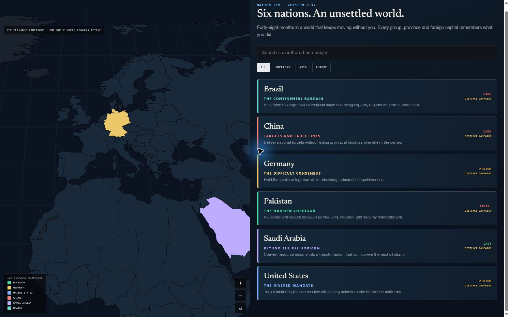
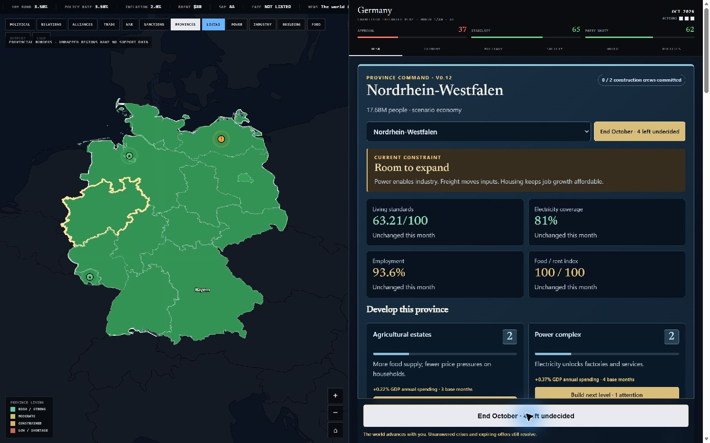
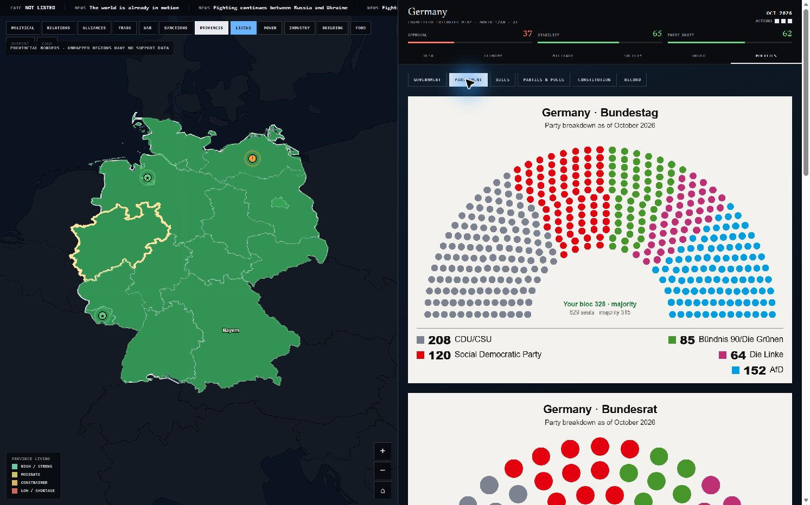
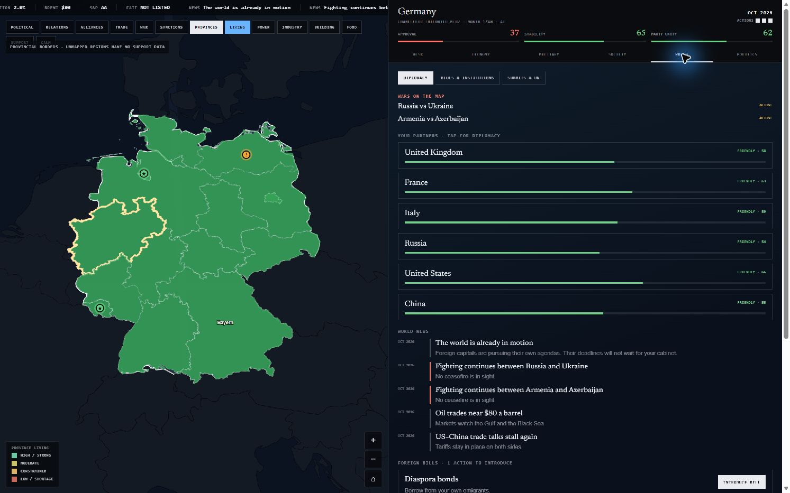
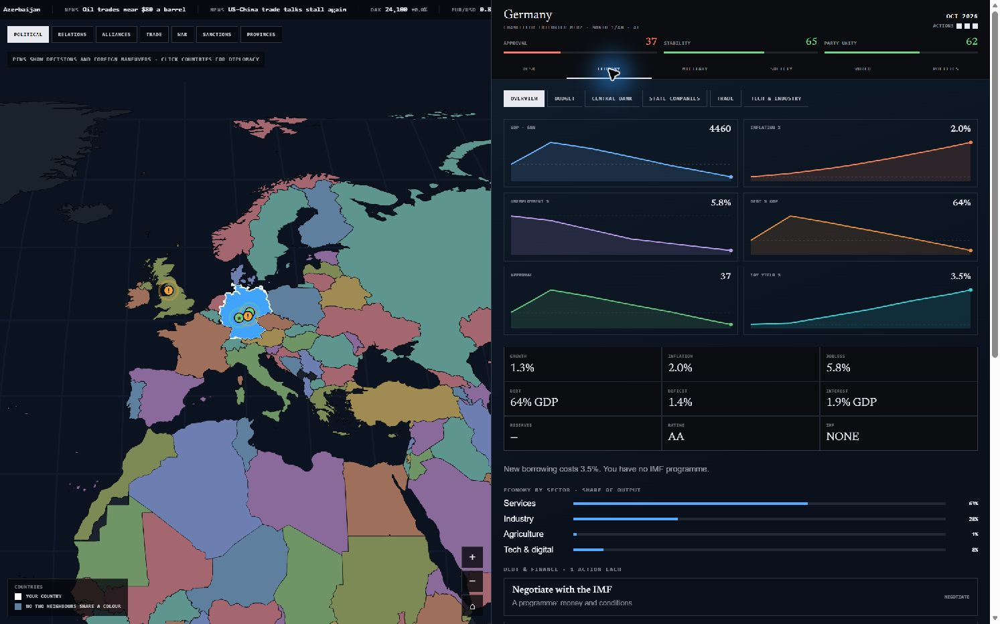
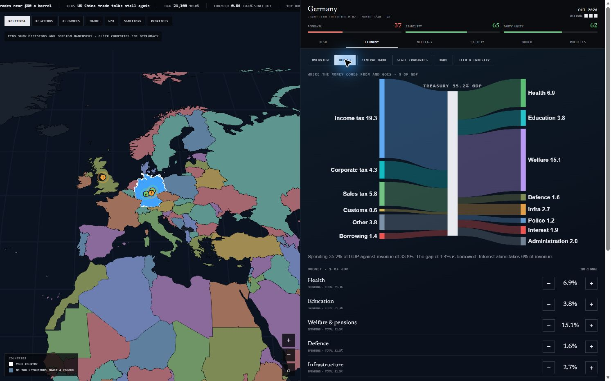
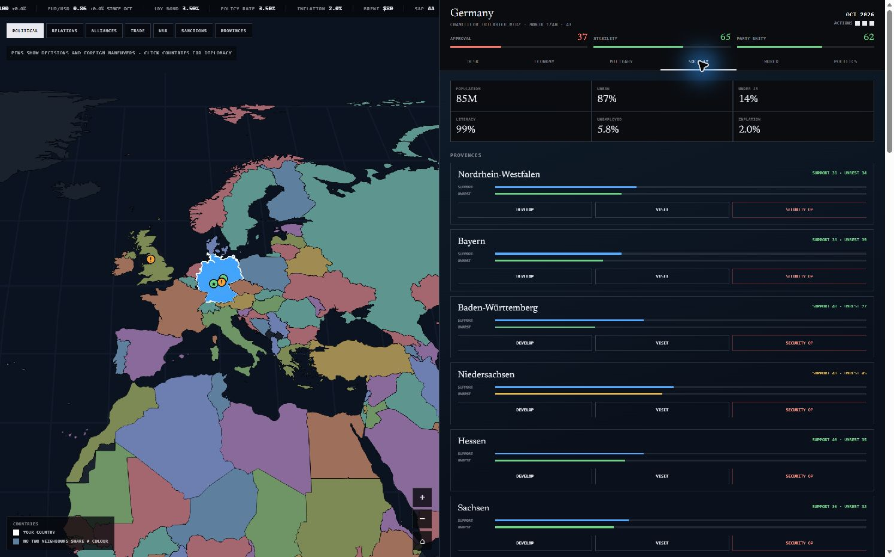
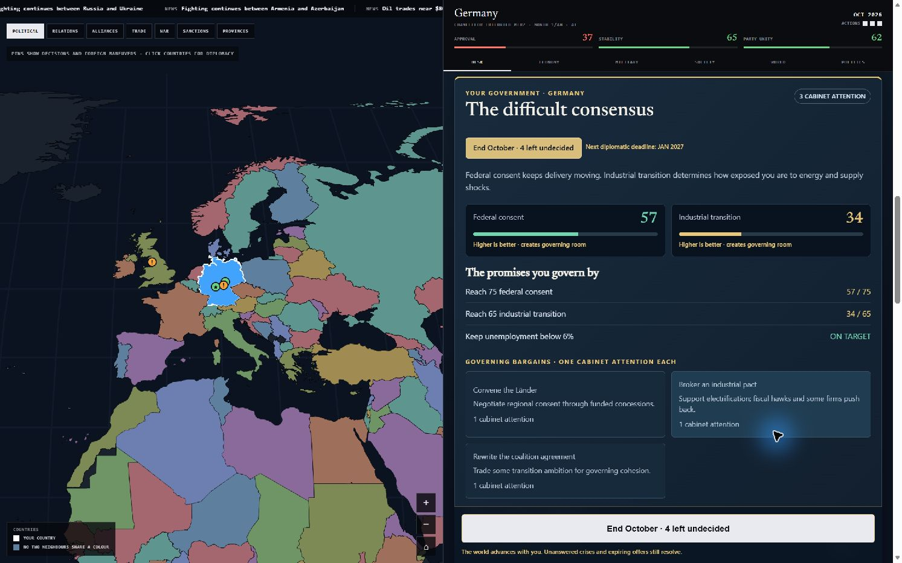

# Nation Simulator

**Work in progress — prototype v0.12.** A turn-based political strategy game with an AI Game Master, six authored campaigns, provincial construction and an independently maneuvering world.

The simulation and automated checks work; browser rendering, live AI behavior and gameplay balance still need playtesting. The project is under active development and is not a finished public release.

## Screenshots

Actual captures of prototype v0.12 running in Microsoft Edge. These show the current interface; balance and live AI behavior remain under development.

**Six distinct campaigns** — choose a government with its own pressures and objectives.



**Province Command** — inspect local living standards, electricity, employment and development options.



**Parliament** — see the seat distribution and the governing bloc's majority.



**World diplomacy** — track foreign relationships, ongoing conflicts and world dispatches.



<details>
<summary>More gameplay: economy, budget, society, and campaign goals</summary>

**Economic overview** — follow output, inflation, unemployment, debt, approval, and borrowing costs.



**Budget policy** — see how taxes and borrowing fund public spending, then adjust spending by department.



**Society** — compare political support and unrest across regions.



**Campaign mandate** — track Germany's federal consent and industrial transition goals, and choose how to spend cabinet attention.



</details>

## Current milestone: provinces you can develop

All six campaigns now simulate their administered ADM1 units: 152 provinces, states, districts and territories in total. Geography is bundled with the game; see [GEOGRAPHY.md](GEOGRAPHY.md) for roster definitions, provenance and limitations. Older authored-country saves gain province economies while preserving matching regional political state.

Select a province on the map or in the Province Command selector. Build agricultural, power, industrial, service, freight and housing capacity. Electricity and freight constrain output; industrial expansion creates jobs but also consumes inputs and increases housing pressure. Workers, farm households and small businesses experience these changes differently.

Construction starts with a visible location and progress marker. Two national construction crews are shared with national projects. Permits, industrial inputs, freight and concurrent commitments affect delivery. Imported materials or local concessions can help, with debt or spending costs. Completion adds a local capacity level once, changes economic performance and leaves operating costs.

Foreign manufacturers periodically choose between a player province and a rival country. A bid competes on infrastructure, stability and negotiated concessions. Winning starts a privately financed construction site; a rival's winning investment continues building abroad and eventually operates. The Game Master receives the competition's actual state and must not invent completed assets.

The map defaults to province development. Switch between living standards, electricity, industry, construction, food and political layers. Selecting a province pans toward it. Site labels progress into operating-capacity markers, and turn reports put tangible development changes first. Province bindings refresh on every state update, fixing a stale-map rendering issue.

Economic quantities are authored scenario scales, not official provincial measurements. The supplied interfaces and live AI still need browser playtesting.

### A concrete first playthrough

Start a new Pakistan campaign and inspect Punjab in Province Command. Compare electricity coverage with industrial capacity. Fund a power complex, then advance the month: the site marker, construction bar and household conditions update. Imported materials can accelerate delivery at a debt cost. When the complex opens, the map highlights the province, its power level increases, and industrial output responds. Expanding industry afterward raises power and housing demand again.

Try to attract the manufacturing investment before the deadline while keeping construction crews available. A stronger bid can still fail if infrastructure and local conditions are inadequate. The rival keeps building if it wins.

The release has a visible **VERSION 0.12** badge to distinguish it from earlier HTML exports. The standalone HTML contains the simulation and province geography; AI functionality still requires the configured server-side `/api/claude` endpoint described below.

## Six governments, a moving world

New games now offer six authored campaigns. The broader country database stays available to the world simulation and diplomacy.

| Campaign | Signature pressures |
| --- | --- |
| Pakistan | Civilian autonomy and financing credibility |
| Germany | Federal consent and industrial transition |
| United States | Legislative window, polarization and month-24 congressional midterms |
| China | Provincial delivery and local fiscal risk |
| Saudi Arabia | Non-oil capacity and public expectations |
| Brazil | Congressional access and forest credibility |

Each country has three exclusive governing bargains, four promises from which the player selects three, two national projects and recurring contextual political dilemmas. Promises are assessed against conditions at the end of the term, rather than being permanently completed by briefly touching a threshold.

Fund projects, intervene in procurement through audits or expedited work, and watch construction progress into operation. Funding increases annual primary spending. Completion removes part of construction spending while retaining operating costs and applying economic benefits once.

The world has persistent actors with agendas, influence, preparation progress and bilateral relationships. Governments, bond markets, shipping interests and a climate coalition maneuver independently; actors prepare responses to moves directed at them. Foreign moves can transmit growth, prices and borrowing pressure through the player's exposure. Diplomatic offers expire and require cabinet attention to accept, counter or decline. These are stylized gameplay mechanics, not a complete geopolitical model.

With AI enabled, ending a month also asks the Game Master to develop the world using its existing history, actor agendas and player commitments. It can author up to two validated moves; autonomous simulation continues if the call fails or times out. No live AI calls are made by tests. The interface labels the world as a simulated timeline: it is not a live-news feed.

The campaign dashboard now shows mandates, governing bargains, project stages, expiring offers, world dispatches and an expandable intelligence desk. Map pins also identify recent foreign maneuvers.

## Simulation foundation

- Economic, political, legislative and world updates finish before reports, end-of-government checks and next-turn snapshots.
- Democratic agenda policies use parliamentary passage. Emergency and non-democratic executive enactment retain the existing authority rules.
- The Game Master assesses custom bills into explicit immediate effects, persistent modifiers, affected groups and risks. The player reviews the assessment before spending an introduction action. Assent applies its effects once.
- Legacy custom bills with missing effects are held for revision rather than silently becoming empty laws.
- Re-selecting an exchange-rate regime cannot repeat its transition effects, and switching is restricted to once per month.
- AI responses are tied to career, month and decision. Reapplying an accepted response has no effect. Prompts include faction pressure, coalition trust, active opposition campaigns and unresolved follow-ups.
- Loading geographic borders no longer rewrites political region records. Regions without a matching geographic name remain unmapped; stable region identifiers and a curated alias table are future work.

## Build and test

Requires Node.js 20 or newer. No dependency installation is required.

```sh
npm test
npm run build
```

`Nation Sim v9 publish.dc.html` is the interface source. `engine9.js`, `sim9.js`, `campaign.js` and `provinces.js` are the simulation sources. Do not hand-edit `deploy/index.html`: the build regenerates it from these files, using the supplied runtime preserved under `build/`.

Publish `deploy/` using a host workflow that deploys its serverless function as well as the HTML. Netlify configuration is supplied. AI requests use `/api/claude`; the server needs `ANTHROPIC_API_KEY` and optionally `CLAUDE_MODEL`. Do not place a key in browser code. No live site or paid AI request was created during this milestone.

## Verification and limits

Automated coverage includes every selectable campaign resolving one month, 18 longer scripted campaigns across three seeds, legislation, custom-bill assessment/confirmation/failure, stale AI replies, duplicate effects and deployment bundle/source consistency. Additional tests cover exclusive country mechanics, country dilemmas, delivery, mandates, midterms, persistent foreign maneuvers, diplomatic deadlines, AI world-director success/failure, all province identities, migration, shared construction capacity, input constraints, households, foreign investment, completed assets and map state rebinding. AI responses in tests are mocked; these checks do not measure actual model quality or gameplay balance.

The modified interface has not been visually playtested in a browser. Existing external map/font resources still require network access. Public AI hosting still needs durable quotas, stronger endpoint validation and operational monitoring. The current proxy's process-memory limiter is not a global spending guarantee.

## Next milestones

1. Live browser and AI playtest of all six campaign flows, including large/small screens and long-session saves.
2. Tune country trade-offs, external spillovers, delivery pace and mandate difficulty using actual player feedback.
3. Expand political actors into richer individual personalities, deeper AI narrative threads and negotiated project commitments.
4. Add original artwork, audio feedback, a guided opening and stronger economic attribution.
5. Harden public AI hosting, conduct external playtests, and prepare release packaging and a portfolio case study.

No claim of economic forecasting accuracy is made. Historical country baselines and institutional assumptions require a separate data review before public release.
